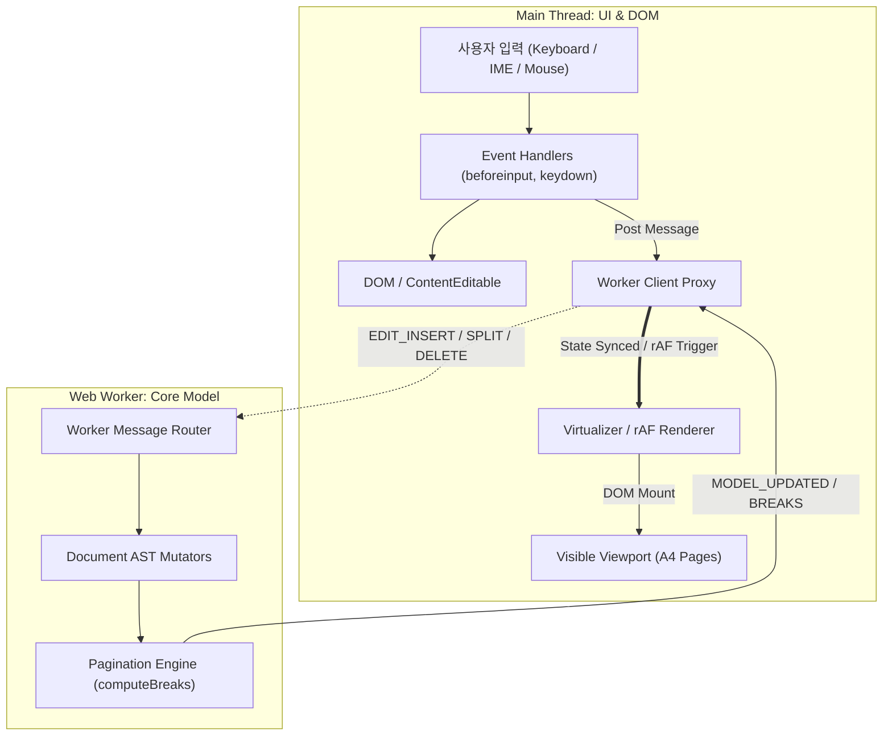

# DOC3

Typescript Wordprocessor based on modern web technology

# dependency

hwp.js https://github.com/hahnlee/hwp.js.git

hwplib-js https://github.com/erickim20/hwplib-js.git

# Structure

The top most abstraction is DocumentModel

## Read

odt, hwpx, docx -> DocumentModel

## Input

Layout and rendering are handled asynchronously. Input, however, must not be handled asynchronously; doing so would disrupt the cursor.

## Write

DocumentModel
-> odt, hwpx, docx
-> hwpFile -> hwp

# DOC3 Editor Architecture: Web Worker & Hybrid Rendering Model

DOC3 에디터는 **타이핑 딜레이(Jank) 없는 부드러운 입력 경험**과 **대용량 문서의 고속 페이지네이션**을 동시에 달성하기 위해, UI 이벤트 처리와 문서 데이터 모델 연산을 분리한 **하이브리드 아키텍처**를 채택하고 있습니다.

---

## 1. High-Level Architecture Overview

에디터는 **Main Thread(UI & DOM)**와 **Web Worker(AST & Layout Model)** 간의 비동기 메시지 통신을 기반으로 동작합니다.

