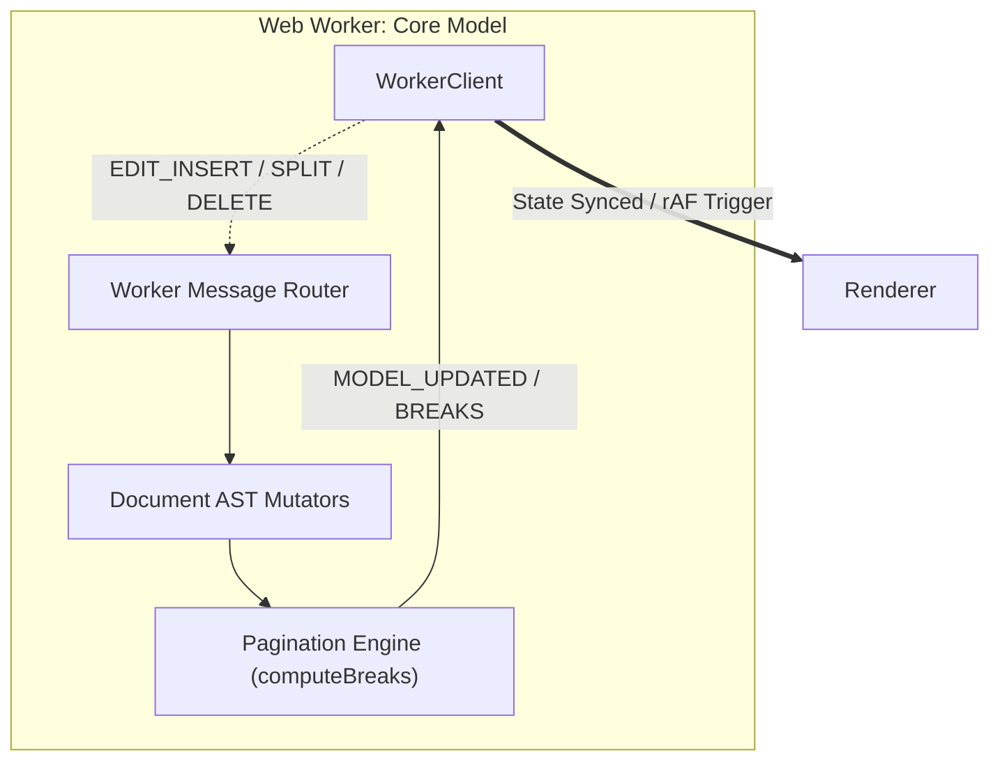

# DOC3

Typescript Wordprocessor based on modern web technology

---

# DOC3 Editor Architecture: Web Worker & Hybrid Rendering Model

DOC3 에디터는 **타이핑 딜레이(Jank) 없는 부드러운 입력 경험**과 **대용량 문서의 고속 페이지네이션**을 동시에 달성하기 위해, UI 이벤트 처리와 문서 데이터 모델 연산을 분리한 **하이브리드 아키텍처**를 채택하고 있습니다.

---

## 1. High-Level Architecture Overview

에디터는 **Main Thread(UI & DOM)**와 **Web Worker(AST & Layout Model)** 간의 비동기 메시지 통신을 기반으로 동작합니다.

## 2. Core Design Principles & Data Flow

### ① Synchronous Model Updates & Asynchronous Rendering (Sync Model, Async Render)
* **Main Thread Responsibilities:** 사용자가 타이핑, 텍스트 삽입, 문단 나누기 등의 입력 액션(`EDIT_INSERT`, `EDIT_SPLIT`)을 수행할 때, UI 스레드가 블로킹되지 않도록 워커에 즉시 명령을 전달하고 커서를 선행 이동시켜 지연 없는(Jank-free) 입력 경험을 보장합니다.
* **Web Worker Responsibilities:** 백그라운드 스레드에서 문서 AST를 갱신하고 줄바꿈 및 페이지네이션 연산(`computeBreaks`)을 처리한 뒤, 변경된 레이아웃 결과를 메인 스레드로 동기화합니다.
* **rAF (RequestAnimationFrame):** 무거운 DOM 리플로우를 방지하고 브라우저 렌더링 주기에 맞춰 뷰포트를 부드럽게 갱신합니다.

### ② IME Composition Safety (Composition Lock & DOM-First Commit)
* **Composition Lock:** 한글, 중국어, 일본어 등 조합 문자 입력 중 외부 렌더링이나 강제 DOM 리빌드로 인한 커서 튐 및 입력 왜곡 현상을 완벽히 방어합니다.
* **DOM-First Commit:** `compositionend` 시점에 브라우저가 최종 확정한 실제 텍스트를 라이브 DOM에서 직접 읽어와(`DOM-first commit`) 모델과 동기화하며, 입력 직후 1프레임 동안 불필요한 리렌더링을 막는 유예 기간(Grace Period)을 두어 네이티브 페인팅을 보호합니다.

### ③ Viewport Virtualization
* **Minimal DOM Footprint:** 전체 문서 페이지를 한 번에 렌더링하지 않고, 현재 스크롤 뷰포트에 위치한 가시 범위(`start` ~ `end`) 페이지만 동적으로 마운트합니다.
* **Accurate Scroll & Layout:** 상하단 Spacer(`topSpacer`, `bottomSpacer`)를 통해 전체 문서의 정확한 높이와 스크롤바 위치를 유지하면서도 DOM 노드 수를 최소화하여 대용량 문서에서도 고성능을 유지합니다.

# dependency

hwp.js https://github.com/hahnlee/hwp.js.git
hwplib-js https://github.com/erickim20/hwplib-js.git

## Read

odt, hwpx, docx 
-> DocumentModel

## Write

DocumentModel
-> odt, hwpx, docx, hwp
